# CotizaPro Plataforma: motor de reglas, vitrina pública y despliegue en VPS

**Estado:** rama `feature/plataforma-motor-vitrina` · trabajo autónomo autorizado, realizado cumpliendo las reglas base (sin commits, sin push, sin cambios a configuración ajena del servidor) · **completo con pendientes que requieren decisión**.

**URL de producción:** https://cotizapro.mariobustos.io (API Supabase propia: https://api.cotizapro.mariobustos.io)

---

## 1. TL;DR

- Fases 0 a 3 implementadas: estabilización y seed multi-cuenta, motor de precios por bloques (`@cotizapro/quoting`), plantillas por giro, listas de precios, vitrina pública `/p/[slug]` con portafolio, reseñas verificadas, solicitudes de cotización y tarjeta QR.
- Desplegado en el VPS compartido con un **Supabase reducido propio** (5 servicios) y la app Next.js, sin tocar la configuración de TokenPass ni Fiable: 9/9 dominios ajenos idénticos antes y después.
- Verificación: 43/43 pruebas del motor (99.6 % de líneas), 23/23 unitarias de la app, E2E local 234 aprobadas y 0 fallas, 20/20 controles de seguridad SQL en producción, build de producción exitoso en el servidor.
- **Lo primero que conviene revisar:** la sección 4 (decisiones autónomas) y la sección 8 (tres hallazgos de seguridad o funcionamiento que requieren decisión, en particular la política RLS de `organizations` y el cron de recordatorios).

---

## 2. Qué se hizo

### 2.1 Motor y plantillas (Fase 2)

| Área | Archivos principales |
| --- | --- |
| Paquete puro del motor | `packages/quoting/src/` (schema, evaluate, validate, blocks/*, templates/*) |
| Precio calculado en servidor | `apps/web/lib/pricing/*`, `app/api/quotes/route.ts`, `app/api/quotes/[id]/route.ts` |
| Listas de precios | `app/api/price-lists/*`, `app/(dashboard)/dashboard/price-lists/page.tsx`, `components/price-lists/*` |
| Partida configurable en nueva cotización | `components/quoting/configurable-item-panel.tsx`, `lib/pricing/configurable-item.ts`, `app/(dashboard)/dashboard/quotes/new/page.tsx` |
| Calculadora de prueba en servicios | `components/price-lists/test-calculator-dialog.tsx`, `try-service-button.tsx`, `rules-summary.tsx` |
| Configuración de cuenta y giro | `app/(dashboard)/dashboard/bienvenida/page.tsx`, `app/api/organization/setup/route.ts`, `lib/onboarding/*`, `components/onboarding/*` |
| PDF | `lib/pdf/QuotePDF.tsx` (unidades en español, iniciales en logo), `lib/pdf/quote-materials.ts` (Lista de materiales) |
| Migración | `supabase/migrations/033_accounts_and_pricing_engine.sql` |

### 2.2 Vitrina (Fase 3)

| Área | Archivos principales |
| --- | --- |
| Página pública y reseña | `app/p/[slug]/page.tsx`, `app/r/[token]/page.tsx`, `components/showcase/*` |
| Editor "Mi página" + QR | `app/(dashboard)/dashboard/vitrina/page.tsx`, `components/showcase-editor/*`, `app/api/showcase/*`, `lib/pdf/qr-card.tsx` |
| Bandeja de solicitudes | `app/(dashboard)/dashboard/solicitudes/page.tsx`, `components/quote-requests/*`, `app/api/quote-requests/*` |
| Fotos y "Pedir reseña" en cotización | `components/quotes/*`, `app/api/upload/job-photos`, `app/api/job-photos/[id]`, `app/api/quotes/[id]/{photos,review-request}` |
| APIs públicas | `app/api/public/{quote-requests,reviews}` (sin service role, límite por IP en BD + limitador de app) |
| Migración y pruebas SQL | `supabase/migrations/034_public_showcase.sql`, `supabase/tests/showcase_security.sql` |

### 2.3 Fase 0 y transversales

- Seed real multi-cuenta idempotente: `apps/web/scripts/seed/` (empresa de vidrio, grupo de electricistas, plomero, costurera).
- E2E nuevos: `e2e/specs/20-workshop-journey`, `21-configurable-product`, `22-public-profile`, `23-review-flow`, `24-quote-request`; helpers `e2e/helpers/{combobox,demo-auth}.ts`; specs previos reparados (Combobox en lugar de `<select>`).
- Combobox compartido con modo oscuro; resumen de cotización con 2 decimales; sidebar con sección "Vitrina" y "Listas de precios".
- Seguridad: IP de cliente tomada del salto derecho de `X-Forwarded-For` (`lib/rate-limit.ts`), honeypot silencioso, revalidación de `/p/[slug]` al cambiar perfil o fotos.
- Infraestructura: `Dockerfile` (node 22, pnpm fijo, paquete `quoting`, ARG de `NEXT_PUBLIC_*`), `.dockerignore`, `.gitignore` (artefactos anidados).
- Documentos: spec `docs/superpowers/specs/2026-10-11-cotizapro-plataforma-design.md`, plan `docs/superpowers/plans/2026-10-11-cotizapro-plataforma.md`, bitácora `docs/handoff/ledger.md`.

### 2.4 Servidor (Fase 1)

| Elemento | Ubicación |
| --- | --- |
| Compose propio (db, auth, rest, storage, realtime, web) | `/opt/cotizapro-deploy/docker-compose.yml` |
| Secretos (600) | `/opt/cotizapro-deploy/.env` |
| Código | `/opt/cotizapro` (rsync del árbol de trabajo) |
| Bloque Caddy | `# >>> cotizapro` en el Caddyfile compartido; fuente `/opt/cotizapro-deploy/Caddyfile`; script `apply-caddy-block.sh` |
| Cron | `/etc/cron.d/cotizapro`: respaldo 03:50, reinicio demo 10:20 UTC |
| Scripts | `/opt/bin/cotizapro-{backup,demo-reset,reminders}.sh` |
| Inventario | `~/.claude/docs/infra/hostinger-vps-inventario.md` §2, §4.4, §5, §6, §10 actualizados |

---

## 3. Arquitectura desplegada

```
Internet ─443─▶ Caddy compartido
                 ├─ cotizapro.mariobustos.io      → cotizapro-web:3000
                 └─ api.cotizapro.mariobustos.io  (CORS solo para la app)
                      /auth/v1     → cotizapro-auth:9999
                      /rest/v1     → cotizapro-rest:3000
                      /storage/v1  → cotizapro-storage:5000
                      /realtime/v1 → cotizapro-realtime:4000/socket
                 cotizapro-db (Postgres 17, sin puerto publicado, red interna)
```

---

## 4. Decisiones autónomas

| Decisión | Por qué | ¿Reversible? |
| --- | --- | --- |
| Supabase reducido propio sin gateway (Kong/Envoy); Caddy enruta por ruta | Menos memoria y piezas; aísla la autenticación de los otros proyectos (opción B acordada) | Sí: agregar un gateway después no cambia la app |
| CORS gestionado en Caddy y limitado a `https://cotizapro.mariobustos.io` | GoTrue no devolvía `Access-Control-Allow-Origin` al preflight con `apikey`; el login del navegador habría fallado | Sí: editar el bloque con `apply-caddy-block.sh` |
| La app web no recibe la service role key ni la contraseña de BD | El código no la usa (solo el health check verificaba su presencia; se quitó de esa lista) | Sí |
| Migraciones 024, 025, 026, 031, 032 registradas como omitidas en producción | Solo contienen datos demo de ClimaSol que dependen de usuarios locales; la única DDL (032) ya está en 030 | Sí: se pueden aplicar si se crea ClimaSol |
| GoTrue con autoconfirmación de correo y SMTP a Mailpit compartido | No hay llave Resend propia; evita bloquear el registro | Sí: cambiar `GOTRUE_SMTP_*` al tener la llave |
| Cron de recordatorios instalado pero **comentado** | La ruta devuelve 500 en producción (ver 5.1); se evita una falla diaria | Sí: descomentar tras el fix |
| Configuración de cuenta ofrecida con banner, no con redirección forzada | No interrumpir cuentas existentes ni las pruebas E2E que entran al dashboard | Sí |
| Plantilla de giro se carga solo si la organización no tiene productos configurables; con compensación si falla | PostgREST no ofrece transacción multi-tabla; evita duplicados al cambiar de giro | Sí |
| "Marcar contactado" no implementado en la bandeja; se agregó "Restaurar" | El esquema solo admite `new / converted / discarded` | Sí: requiere migración |
| Borrado de foto: primero el registro, luego el archivo | Un archivo huérfano es inofensivo; un registro sin archivo rompe el portafolio | Sí |
| Estrellas con medias (4.5 = cuatro y media) | `Math.round(4.5)` mostraba cinco estrellas llenas | Sí |
| Dos agentes en paralelo para bandeja de solicitudes y listas de precios | Pantallas independientes; se definieron archivos prohibidos para evitar choques | No aplica |
| No crear la cuenta real de MEGAGLASS ni probar con sesión en producción | Crear cuentas o iniciar sesión en un sitio de producción queda fuera de lo permitido de forma autónoma | Pendiente para el responsable |

---

## 5. Hallazgos y cómo se resolvieron

### 5.1 Requieren decisión (no corregidos)

1. **Seguridad, preexistente:** la política RLS "Only owners can update organization" permite al dueño cambiar cualquier columna, incluidas `plan` y `subscription_status`, desde el navegador. Propuesta: trigger que bloquee esas columnas para `authenticated`, o moverlas a una tabla de facturación escrita solo por el webhook.
2. **Funcional, preexistente:** `/api/cron/reminders-check` consulta todas las organizaciones con el cliente anónimo; RLS lo bloquea y responde 500. Requiere cliente con service role limitado a esa ruta o una función `SECURITY DEFINER` dedicada. Aplica el ciclo de corrección de bugs con Gate 1.
3. **Seguridad, preexistente:** `create_organization_with_owner` es `SECURITY DEFINER` y acepta un `owner_id` arbitrario.

### 5.2 Corregidos durante el trabajo

| Hallazgo | Corrección |
| --- | --- |
| Límite por IP evadible con `X-Forwarded-For` falsificado (app y vitrina) | Se toma el salto derecho; pruebas unitarias |
| Convertir solicitud no verificaba el update de estado | Devuelve 500 con mensaje claro |
| Coincidencia de cliente por teléfono exacto (duplicaba clientes con formato) | Comparación por últimos 10 dígitos |
| Honeypot devolvía 400 informativo al bot | Responde 201 sin registrar; E2E lo comprueba |
| Combobox ilegible en modo oscuro | Clases dark en el componente compartido |
| Resumen de cotización con 3 decimales | `formatAmount` con 2 decimales |
| PDF con unidad cruda ("fixed") y glifo roto en logo | Etiquetas en español e iniciales |
| CSP bloqueaba Supabase en otro origen | Origen derivado de `NEXT_PUBLIC_SUPABASE_URL` |
| Dockerfile no podía construir esta versión | node 22, pnpm fijo, manifiesto de `quoting`, ARG de `NEXT_PUBLIC_*` |
| Health check exigía la service role key | Se quitó de la lista; la app no la usa |
| Seed reportaba "climasol vitrina publicada" aunque no existiera | Reporta `[skip]` cuando no existe |
| Migración 032 con columna inexistente (`default_terms`) | Corregida a `default_terms_and_conditions` (desviación del ciclo de bugs: requiere Gate 2) |

### 5.3 Asperezas conocidas, sin corregir

- `PaymentSection` sin estilos de modo oscuro (bloque blanco en detalle de cotización).
- En la fila móvil de nueva cotización sigue un `<select>` nativo (preexistente).
- Editor de listas: muestra claves internas (`corredizo-aluminio`) como valores y deja un hueco amplio entre columnas; renombrar un valor puede romper productos que lo usan, sin advertencia; listas archivadas no se restauran desde la UI.
- Bandeja de solicitudes sin paginación ni contadores por estado; `quote_requests.quote_id` nunca se llena.
- Botón "Nuevo Evento" azul fuera de paleta.
- Lint preexistente: `any` en `e2e/helpers/{api,database}.helper.ts`, `setState` en efecto en `sidebar.tsx`.

---

## 6. Verificación realizada

| Verificación | Resultado |
| --- | --- |
| `packages/quoting`: vitest con cobertura | 43/43 · líneas 99.61 % · ramas 90.79 % |
| `apps/web`: vitest | 23/23 (7 archivos) |
| `tsc --noEmit` (apps/web) | limpio |
| ESLint sobre código nuevo | sin hallazgos nuevos (solo preexistentes listados en 5.3) |
| E2E local completo (Playwright, :3100) | 234 aprobadas · 17 omitidas (skips condicionales preexistentes) · 0 fallas |
| E2E nuevos 20–24 | aprobados, incluido `--repeat-each=2` en 24 |
| Build de producción (Docker en el servidor) | exitoso dos veces |
| Migraciones en producción | 22 aplicadas en transacción + 5 registradas como omitidas |
| Controles de seguridad SQL en producción | 20/20 |
| Acceso anónimo a 9 tablas por REST en producción | todas devuelven `[]` |
| E2E anónimos contra producción (vitrina, fotos, 404) | 3/3 |
| Realtime por Caddy | handshake WebSocket 101 |
| §0 coexistencia | 9/9 dominios ajenos 200 antes y después; inode del Caddyfile conservado; nslookup de alias genéricos sin duplicados |
| Respaldo | `cotizapro-*.sql.gz` y `cotizapro-storage-*.tar.gz` generados y verificados con `gzip -t` |

No verificado: flujos con sesión iniciada en producción (requieren que el responsable inicie sesión), estado de solo lectura de listas con rol `member`, envío real de correo.

---

## 7. Evidencia

**Partida configurable en nueva cotización (local).** Cancel 1200 × 1800 mm, 6 mm: subtotal $5,412.40 con desglose; la cotización COT-2026-043 quedó guardada con el mismo total. Correcto: el desglose y el total coinciden con el servidor. Mejorable: la descripción se trunca en la columna.

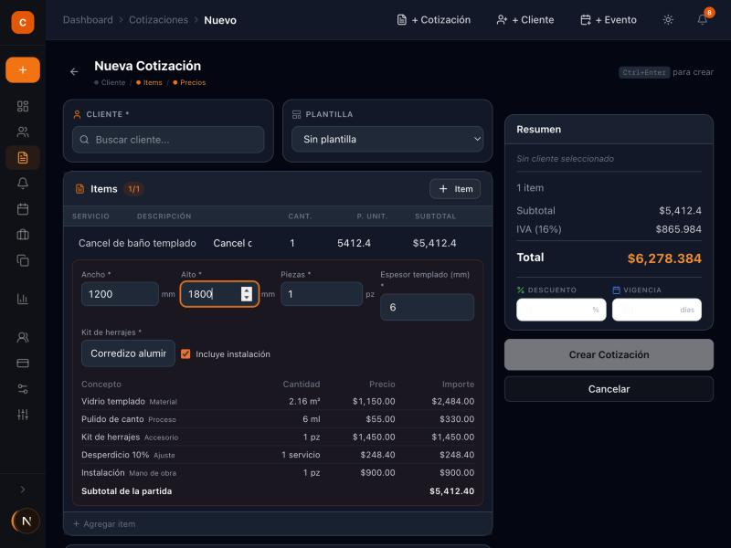

**Listas de precios.** Edición en línea, ajuste porcentual y aviso de cotizaciones congeladas. Mejorable: claves internas visibles y hueco entre columnas; "Guardar" deshabilitado se ve poco distinto del activo.

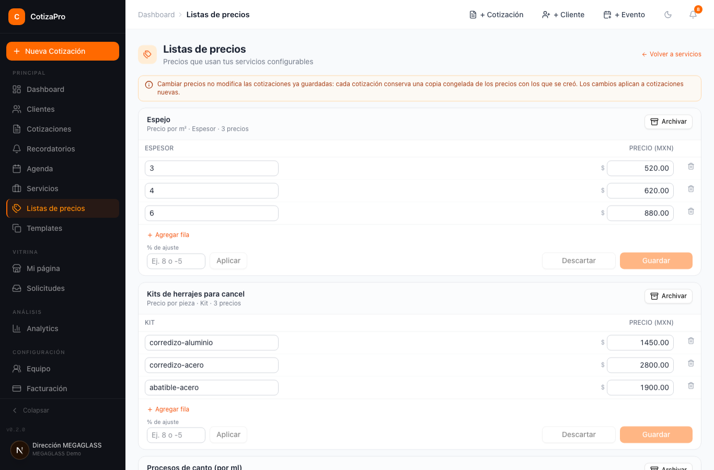

**Calculadora de prueba en servicios.** Mismo resultado que la cotización ($5,412.40) y reglas en lenguaje claro. Correcto.

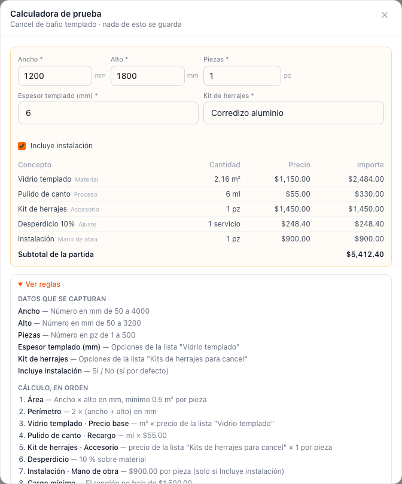

**Editor "Mi página".** Datos, publicación, liga y QR. Correcto en modo oscuro.

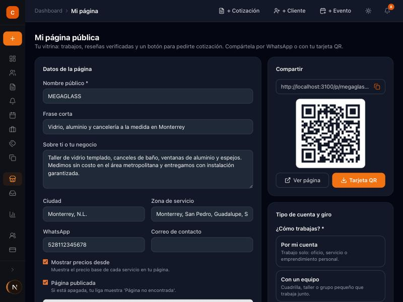

**Tarjeta QR (PDF 4 × 6 in).** Legible y escaneable. Esta captura es anterior al formato del teléfono (ahora se imprime `+52 81 1234 5678`).


**Fotos del trabajo y "Pedir reseña" en una cotización cobrada.** Subida, marcado "En mi página" y ligas de WhatsApp, correo y copia. Mejorable: el bloque de pagos superior no tiene modo oscuro.

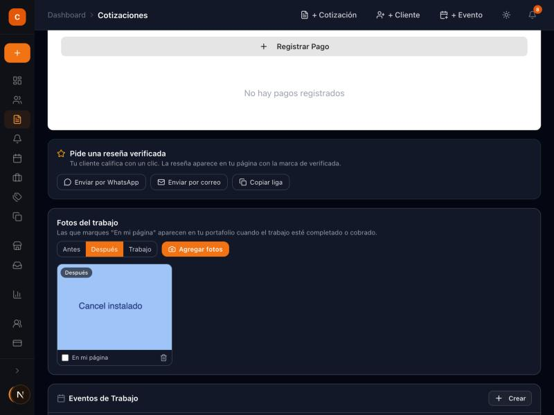

**PDF de cotización con lista de materiales.** Unidades en español, iniciales en el logo y materiales agregados de las partidas configurables. Mejorable: la descripción "Espesor (mm) 3" se lee técnica.

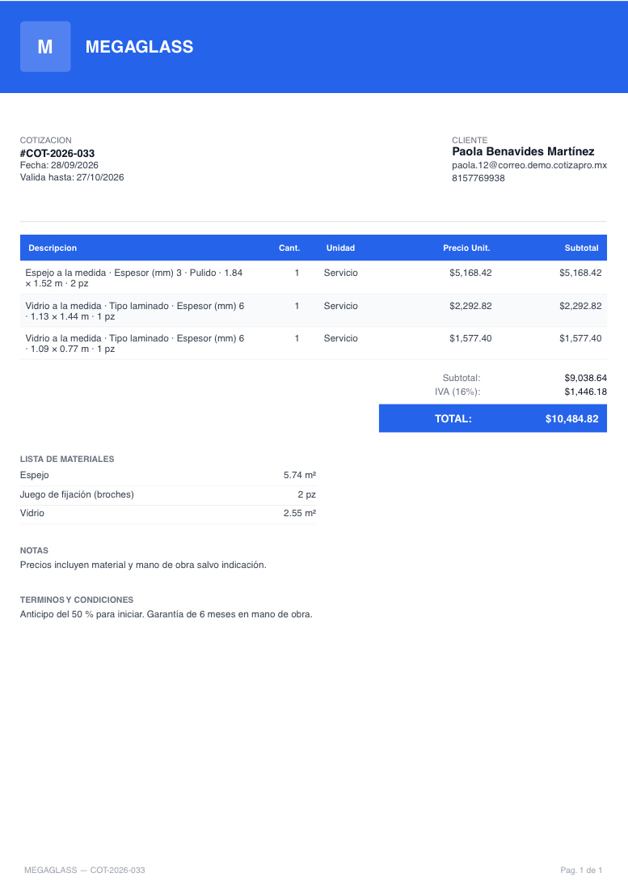

**Vitrina pública en producción (375 px).** https://cotizapro.mariobustos.io/p/costuras-lupita. Captura previa al ajuste de medias estrellas (mostraba 5 llenas para 4.5; ya corregido y verificado en el HTML desplegado).

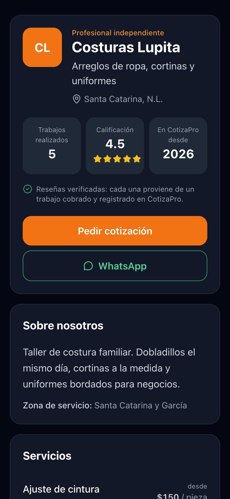

**Vitrina local: encabezado, fotos antes y después del ajuste de CSP, validación y envío de solicitud.**

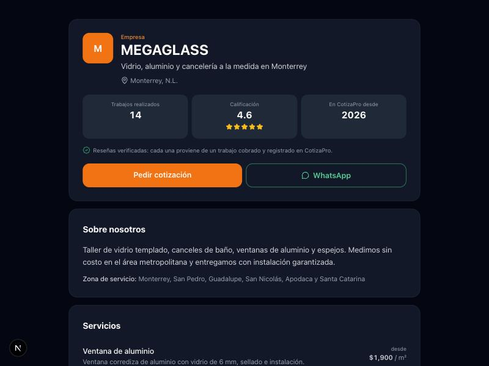
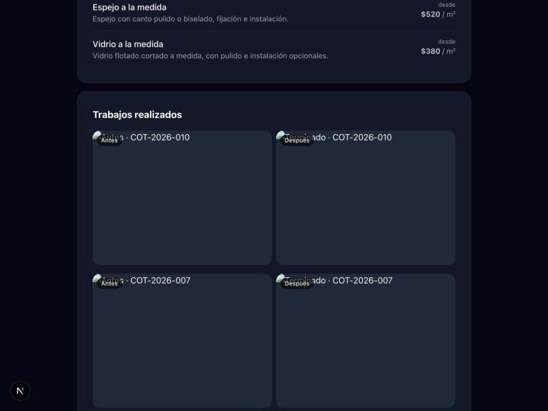
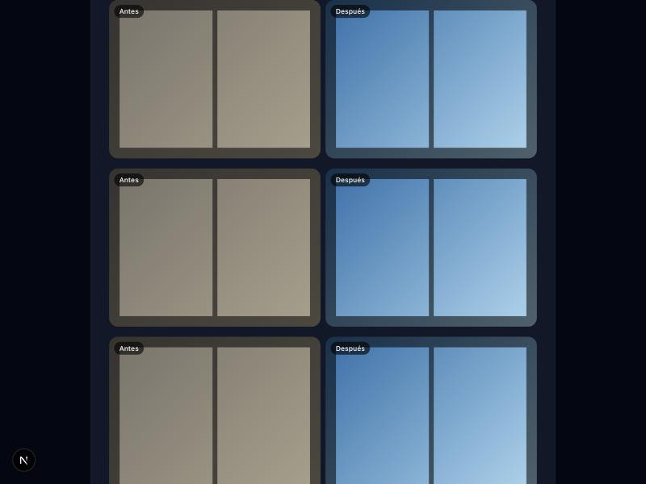
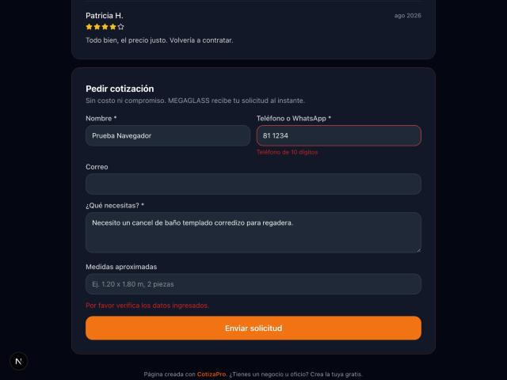
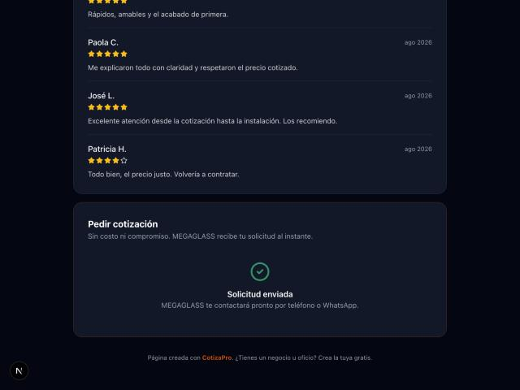

---

## 8. Pendiente / requiere decisión

Prioridad alta:

1. **Revisar y aprobar commits** (no se hizo ninguno). Agrupación propuesta:
   - `feat: motor de precios por bloques, listas de precios y plantillas por giro` — `packages/quoting`, `lib/pricing`, `lib/onboarding`, `components/quoting`, `components/price-lists`, `components/onboarding`, páginas `price-lists` y `bienvenida`, rutas `price-lists`, `pricing`, `organization`, migración 033, nueva cotización, PDF.
   - `feat: vitrina pública, reseñas verificadas, solicitudes y QR` — `app/p`, `app/r`, `components/showcase*`, `components/quotes`, `components/quote-requests`, páginas `vitrina` y `solicitudes`, rutas `public`, `showcase`, `quote-requests`, `job-photos`, `upload`, migración 034, pruebas SQL, middleware, CSP, rate-limit.
   - `chore: seed multi-cuenta, E2E, Docker y documentación` — `scripts/seed`, `e2e/*`, `Dockerfile`, `.dockerignore`, `.gitignore`, `vitest.config.ts`, migración 032, `docs/superpowers`, `docs/handoff`.
   - Excluir: `*.png` sueltos en la raíz y `supabase/` en la raíz (preexistentes, marzo 2026), `playwright-report/index.html` (borrado preexistente).
2. **Decidir los hallazgos 5.1** (RLS de `organizations`, cron de recordatorios, `create_organization_with_owner`).
3. **Crear la cuenta real de MEGAGLASS** en https://cotizapro.mariobustos.io/signup y completar "Configura tu cuenta" (giro vidrio).
4. **Llave Resend propia:** crearla en resend.com, guardarla en `/opt/cotizapro-deploy/.env` (`RESEND_API_KEY`) y cambiar `GOTRUE_SMTP_*`; después desactivar la autoconfirmación si se desea.

Prioridad media:

5. Gate 2 de la corrección de la migración 032.
6. Asperezas de 5.3 (modo oscuro de pagos, claves visibles en listas, paginación de solicitudes).
7. Contraseña demo de producción: vive solo en el `.env` del servidor; compartirla con evaluadores por un canal seguro si se usa en demostraciones.

---

## 9. Cómo re-probar

Local:

```bash
cd apps/web && pnpm exec vitest run
cd packages/quoting && pnpm exec vitest run --coverage
cd apps/web && PLAYWRIGHT_TEST_BASE_URL=http://localhost:3100 pnpm exec playwright test --project=chromium
SEED_DEMO_PASSWORD='CotizaDemo-Local-2026' pnpm --filter web seed
```

- Usuario demo local: `direccion@megaglass.demo.cotizapro.mx` (contraseña documentada en `apps/web/scripts/seed/README.md`).
- Rutas a recorrer: `/dashboard/quotes/new` (servicio "Cancel de baño templado"), `/dashboard/price-lists`, `/dashboard/services` → "Probar", `/dashboard/vitrina`, `/dashboard/solicitudes`, una cotización cobrada → "Pedir reseña", `/p/megaglass-demo`.

Producción:

- Vitrinas públicas: https://cotizapro.mariobustos.io/p/megaglass-demo, `/p/cuadrilla-voltaje`, `/p/plomeria-don-beto`, `/p/costuras-lupita`.
- Estado del stack: `ssh root@2.25.244.18 'cd /opt/cotizapro-deploy && docker compose ps'`.
- Redeploy: rsync del repo a `/opt/cotizapro` y `docker compose build cotizapro-web && docker compose up -d cotizapro-web` (lanzar con `setsid nohup`).
- Cambiar Caddy: editar `/opt/cotizapro-deploy/Caddyfile` y ejecutar `/opt/cotizapro-deploy/apply-caddy-block.sh`; después, smoke de todos los dominios (skill `hostinger-vps` §0).
